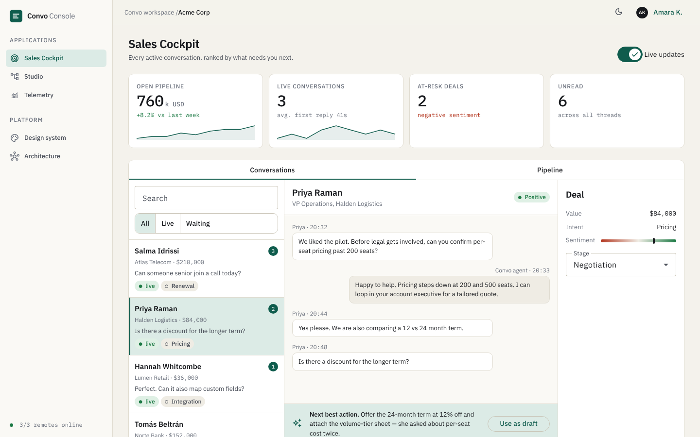
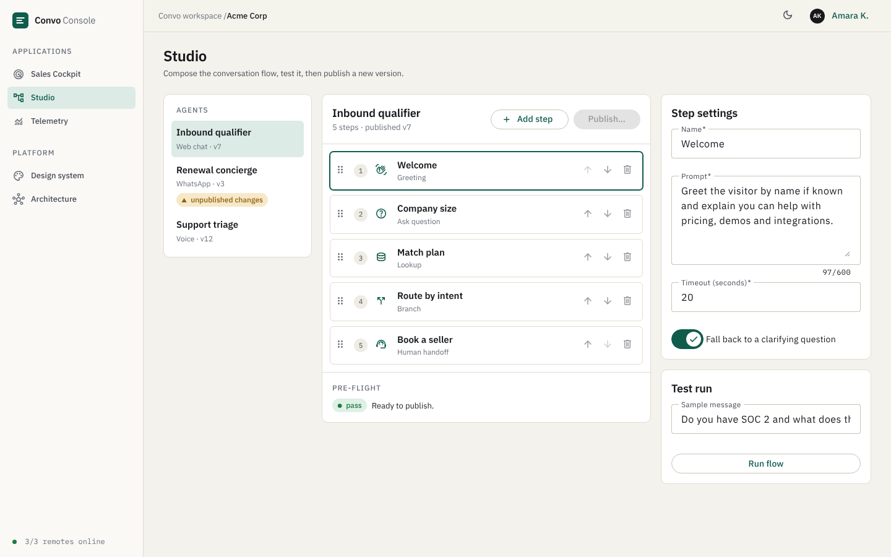
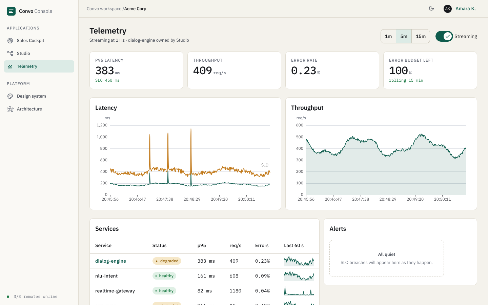
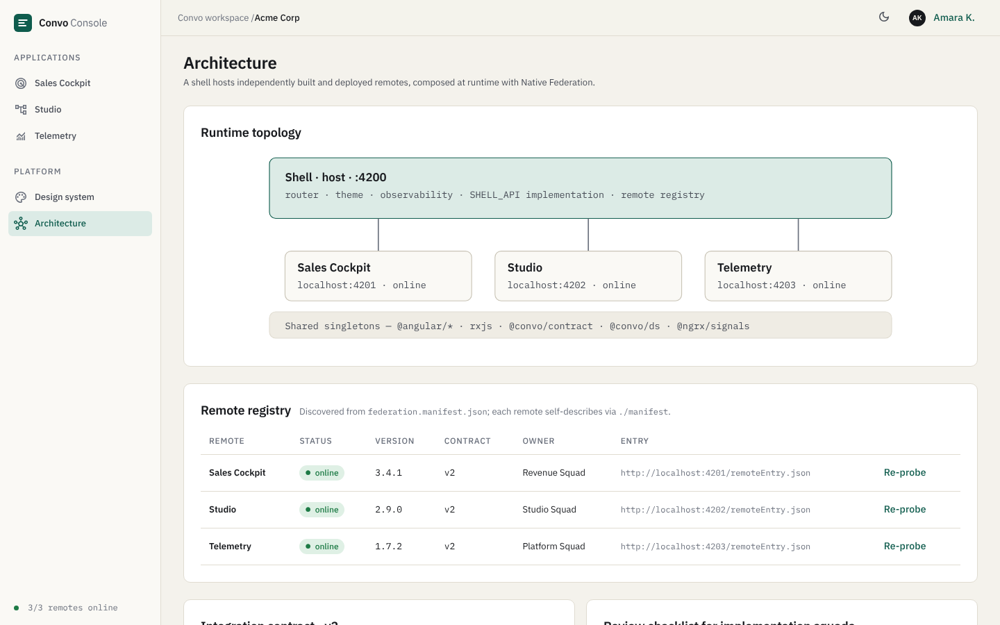

# Convo Console: Angular micro-frontend platform

A working reference implementation of a **micro-frontend architecture in Angular 22**: a shell (host) that discovers and mounts independently built and deployed remotes at runtime with **Native Federation**, a shared **design system**, signal-based state with **NgRx SignalStore**, real-time telemetry views, and a test and accessibility harness.

It models the front end of a conversational-AI product with three applications:

| App | Port | What it does |
| --- | --- | --- |
| **Shell** (host) | 4200 | Navigation, theming, error boundary, remote registry, `SHELL_API` implementation, observability |
| **Sales Cockpit** (remote) | 4201 | Live conversation queue with real-time inbound messages, transcript, next-best-action, deal stage, pipeline chart and table |
| **Studio** (remote) | 4202 | Conversation-flow editor: drag/keyboard reordering, validated step inspector, dry-run test trace, pre-flight checks and publish with versioning |
| **Telemetry** (remote) | 4203 | 1 Hz streaming latency / throughput / error-rate charts, SLO lines, service health table, live alert feed, error budget |

The shell also hosts two platform pages: **Design system** (living tokens and component docs) and **Architecture** (live topology, remote registry, integration contract, review checklist).






> All data is simulated in the front end (deterministic seeds plus timers standing in for WebSocket streams). There is no backend. The seams where real APIs would plug in are the `*.store.ts` files.

---

## Quick start

Requires Node 22+ and npm 10+.

```bash
npm install
npm start            # serves shell + 3 remotes together: http://localhost:4200
```

Each app also runs on its own, which is how a remote team works day to day:

```bash
npx ng serve cockpit      # http://localhost:4201, uses a standalone ShellApi stub
npx ng serve studio       # http://localhost:4202
npx ng serve telemetry    # http://localhost:4203
```

| Script | Purpose |
| --- | --- |
| `npm start` | Run all four apps with `concurrently` |
| `npm run build` | Production build of every remote, then the shell |
| `npm test` | Unit tests (Vitest via `@angular/build:unit-test`) for all four projects |
| `npm run e2e` | Playwright journeys + axe accessibility scans (starts the stack if it isn't running) |
| `npm run storybook` | Storybook for the design system at http://localhost:6006 |
| `npm run build-storybook` | Static Storybook build into `storybook-static/` |
| `npm run test:visual` | Visual regression: every story, light + dark, against committed baselines (needs `build-storybook` first) |
| `npm run test:visual:update` | Regenerate baselines after an intentional visual change |

For e2e on a machine with a pre-installed Chromium, set `CHROME_PATH=/path/to/chrome`.

---

## Architecture

```
                 ┌───────────────────────────────────────────────┐
                 │  Shell (host)  :4200                          │
                 │  router · theme · observability · SHELL_API   │
                 │  remote registry · error boundary             │
                 └──────┬───────────────┬───────────────┬────────┘
       federation.manifest.json         │               │
              ┌─────────▼───┐   ┌───────▼─────┐   ┌─────▼───────┐
              │ cockpit     │   │ studio      │   │ telemetry   │
              │ :4201       │   │ :4202       │   │ :4203       │
              │ remoteEntry │   │ remoteEntry │   │ remoteEntry │
              └─────────────┘   └─────────────┘   └─────────────┘
   Shared singletons: @angular/*  rxjs  @ngrx/signals  @convo/contract  @convo/ds
```

### How composition works

1. The shell boots and `initFederation()` loads `public/federation.manifest.json`, a map of `remoteName → remoteEntry.json URL`.
2. A `provideAppInitializer` calls `RemoteRegistry.discover()`, which loads each remote's exposed `./manifest` module (identity, version, owner, contract major). Probes run in parallel with a 4 s timeout.
3. Routes are generated from the result with `router.resetConfig`. Online remotes get `loadChildren` pointing at the remote's exposed `./routes`. Offline or incompatible remotes get a **fallback page** with a *Retry* action.
4. The sidebar is built from the manifests, so a remote adds or renames itself without a shell release.

Adding a remote to production is therefore one line in `federation.manifest.json`; no shell code changes.

### Integration contract (`@convo/contract`, v2)

Each remote **exposes**:

| Exposed module | Contents |
| --- | --- |
| `./manifest` | `MANIFEST: RemoteManifest`: `id, label, icon, version, shellApi, owner, description` |
| `./routes` | `REMOTE_ROUTES: Routes`: a standard Angular route table (with the remote's store as a route-level provider) |

The shell **provides** one injection token, `SHELL_API`:

```ts
interface ShellApi {
  version: number;
  theme: Signal<'light' | 'dark'>;
  track(event: string, props?: Record<string, string | number | boolean>): void;
  notify(message: string, kind?: 'info' | 'success' | 'error'): void;
}
```

Remotes never reach into shell internals or into each other. `@convo/contract` is a federation **singleton**, so host and remotes share the same token instance at runtime.

**Versioning:** `SHELL_API_VERSION` is a major number. Additive changes keep the major. A breaking change bumps it, and the shell then marks any remote built against the old major as *incompatible* (fallback page and a warning in the nav) while everything else keeps working.

### Failure isolation

A remote that is down, slow (> 4 s) or incompatible never blocks shell start-up. It degrades to an in-place error boundary with a retry button, and the sidebar footer shows `n/3 remotes online`. This is covered by an e2e test that aborts all requests to the telemetry remote.

### Shared dependencies

`federation.config.mjs` in each project shares Angular, RxJS, NgRx Signals and the two workspace libraries as **strict singletons** (`requiredVersion: 'auto'`). Workspace libraries are shared via `sharedMappings` (`mappingsFromWorkspace().filter(['@convo/*'])`), so there is exactly one design system and one `SHELL_API` token on the page. Initial JS per app is about **46 kB gzipped** in production.

---

## Repository layout

```
projects/
  shell/            Host app: shell chrome, registry, fallback, platform pages (design system, architecture)
  cockpit/          Remote: Sales Cockpit
  studio/           Remote: Studio flow editor
  telemetry/        Remote: real-time telemetry
  shared/
    contract/       @convo/contract: RemoteManifest, ShellApi, SHELL_API token, version
    ds/             @convo/ds: design-system components + their *.stories.ts
    styles/         tokens + Material theme mapping (consumed by every app's styles.scss)
e2e/                Playwright journeys and axe scans (whole app)
e2e-visual/         Visual regression suite + committed baselines (__screenshots__)
.storybook/         Storybook config (main, preview, tsconfig)
docs/screenshots/
```

Each remote follows the same internal layout (`manifest.ts`, `remote.routes.ts`, `<name>.store.ts`, `<name>.models.ts`, `<name>.data.ts`, `<name>-page.*`, `app.ts`/`app.config.ts` as a standalone harness).

---

## Design system

Tokens live in `projects/shared/styles/_tokens.scss` as CSS custom properties: colour (light and dark), type scale, spacing, radius, motion and focus ring. They are the single source of truth.

* **Angular Material is themed, not restyled.** `styles/_global.scss` maps Material's `--mat-sys-*` system tokens onto the Convo tokens, so every Material component (buttons, form fields, tabs, tables, dialog, menu, snackbar, slide-toggle, button-toggle, tooltip, select) inherits the brand with no per-feature overrides. Density is set to compact for data-heavy screens.
* **Custom components** live in `@convo/ds`. They are standalone and `OnPush`, and take signal `input()`s:
  * `ds-badge`: status pill. The glyph varies per tone, so colour is never the only signal.
  * `ds-stat`: KPI tile with delta, trend colour and optional sparkline.
  * `ds-sparkline`: dependency-free SVG trend line.
  * `ds-chart`: themed ECharts wrapper (tree-shaken imports, re-themes on light/dark, resizes with its container via `ResizeObserver`, honours `prefers-reduced-motion`). **Requires** `label` and `summary` inputs, which become the canvas's accessible name and text equivalent.
  * `ds-empty`: empty-state pattern.
* **Typography:** IBM Plex Sans for UI text and IBM Plex Mono with tabular figures for every number, so columns align and streaming values don't jitter.
* **Dark mode:** `data-theme` on `<html>`, persisted in `localStorage`, defaulting to the OS preference. Every colour pair is checked by axe in CI.
* The **Design system** page (`/system`) documents tokens, component APIs and states.

---

## State management

* **NgRx SignalStore** (`@ngrx/signals`) per remote: `withState` / `withComputed` / `withMethods` / `withHooks`. Stores are provided at the **route level**, so state is created when a remote is entered and scoped to it. No global store, no cross-remote state.
* **Real-time streams:** RxJS `interval` feeds are bridged into stores with `rxMethod` inside `withHooks.onInit`, honouring a pause toggle (*Live updates*, *Streaming*). Replace the interval with a WebSocket or SSE observable and nothing else changes.
* Derived data (filters, rollups, SLO health, validation issues, error budget) is `computed`, never imperatively synced.
* Immutable updates throughout, so everything works with `OnPush` and signal change detection.

## Real-time and data visualisation

* **Telemetry**: four services streaming at 1 Hz into a 900-point ring buffer (15 min). Range toggles (1m / 5m / 15m) are a computed window over the buffer. SLO breaches (p95 > SLO) raise an alert once per breach, not once per sample. Health is derived from p95 vs SLO and error rate. The error budget is a rolling calculation.
* **Cockpit**: simulated inbound messages arrive every 9 s, bump unread counts, re-rank the queue and announce via an `aria-live` region without stealing focus. The pipeline view pairs a bar chart with a Material table, so every figure is available as text.

## Storybook

Storybook 10 (`@storybook/angular`) documents the design system in isolation: `npm run storybook`.

* **Stories** sit beside the components in `projects/shared/ds/*.stories.ts` (badge, stat, sparkline, empty state, chart) plus a *Foundations* group for colour tokens, the type scale and the Material components as themed by the tokens. Each component has autodocs generated from its signal `input()`s.
* **Theme toolbar** switches light/dark. The preview sets `data-theme` and feeds the same theme signal the shell provides through `SHELL_API`, so `ds-chart` re-themes exactly as it does in the app.
* **Accessibility:** `@storybook/addon-a11y` runs axe on every story in the UI.
* **Deterministic by design:** stories use fixed data (no timers or randomness), and fonts and icons are **self-hosted** (`@fontsource/*`, `material-symbols`) so renders never depend on the network.
* Storybook is built through a small `design-system` project in `angular.json`, which carries the shared global styles.

## Visual regression testing

`e2e-visual/` turns **every story into a screenshot test, in light and dark** (36 today, 18 stories x 2 themes). New stories are picked up automatically from the built `storybook-static/index.json`.

```bash
npm run build-storybook         # once, and after any component/token change
npm run test:visual             # compare against baselines in e2e-visual/__screenshots__
npm run test:visual:update      # accept intentional changes, then review the PNG diff in git
```

How it works: Playwright serves the static Storybook, opens each story's isolated `iframe.html?id=...&globals=theme:<light|dark>`, waits for fonts and canvas charts to settle, and runs `toHaveScreenshot` on the story root (animations disabled, `maxDiffPixelRatio` 0.002). On failure it writes expected/actual/diff images to `test-results/` and an HTML report to `playwright-report-visual/`.

Notes for contributors and CI:

* Baselines are **platform-specific** (font rasterisation and anti-aliasing). They were generated on Linux with Chromium; generate and compare in the same environment (e.g. the Playwright Docker image in CI), never mix OSes.
* Review baseline changes like code: a changed PNG in a PR is the visual diff.
* The suite was verified to be sensitive: temporarily changing `--accent` fails the affected stories, and reverting restores a clean run.
* It already paid for itself. Its first baselines exposed a real bug in `ds-chart`: option objects were merged shallowly, so any chart that set `xAxis`/`yAxis` lost the themed grid and label colours (bright white gridlines in dark mode). The component now deep-merges options.

## Accessibility

* Skip link, landmark structure, one `h1` per view, visible focus ring from tokens.
* Everything is keyboard-operable. **Drag-and-drop reordering in Studio has explicit "Move up / down" buttons** and an `aria-live` announcement, so it isn't pointer-only.
* Charts expose `role="img"` with a label and data summary. Status is never colour-only.
* `aria-current`, `aria-pressed`, `role="log"`, `role="meter"`, `role="status"` / `alert` used where semantics call for them.
* **Automated:** axe-core (WCAG 2.0 A/AA) scans every route in e2e and fails on serious or critical issues. Writing these tests surfaced real colour-contrast defects in the first iteration of the tokens, which were fixed at the token level.

## Testing

* **Unit (20 tests, Vitest):** store logic for each remote (validation rules, reordering, publish versioning, test-run branching, filtering, rollups, ring-buffer bounds, SLO classification) and the shell's route-building / degradation logic.
* **E2E (11 tests, Playwright):** federation mounts all remotes, fallback isolation when a remote is blocked, axe scans for all five routes, and the critical workflows: *Cockpit* (open thread → use suggestion → send → change stage → toast), *Studio* (validation blocks publish → fix → publish v4; keyboard reorder), *Telemetry* (switch service).

```bash
npm test
npm run e2e
```

## Observability

`Observability` (shell) is a ring buffer for product events (`SHELL_API.track`), uncaught errors (a custom `ErrorHandler`) and Core Web Vitals (`PerformanceObserver` for LCP and FCP). Remotes only call `track()`, so analytics can't diverge per team. To ship data off-box, swap the buffer for a Sentry / Datadog RUM sink in one place.

## Standards and review checklist for implementation squads

The in-app **Architecture** page (`/architecture`) carries the checklist external teams are reviewed against:

* **Boundaries:** talk to the shell only through `SHELL_API`; no cross-remote imports; shared code goes in `@convo/*`.
* **Design system:** tokens only (no hex or px literals); prefer `@convo/ds` and themed Material.
* **Accessibility:** keyboard, focus, `label` + `summary` on charts, live regions, clean axe run.
* **Performance:** signals + `OnPush`; route-level lazy loading; remote initial bundle ≤ 250 kB gzip; virtualise long lists.
* **Testing:** store unit tests, a Playwright journey per critical flow with axe assertions, contract tests against the shell's `SHELL_API` version.
* **Observability:** product events via `track`, errors through the shared handler, version published in the manifest.

---

## Adding a new remote

1. `npx ng g application billing --routing --style=scss`
2. `npx ng g @angular-architects/native-federation:init --project billing --port 4204 --type remote`
3. In `projects/billing/federation.config.mjs` expose `./manifest` and `./routes` and copy the `sharedMappings` line from another remote.
4. Export `MANIFEST` (using `SHELL_API_VERSION`) and `REMOTE_ROUTES`; code against `SHELL_API` only; import UI from `@convo/ds`.
5. Add `"billing": "http://localhost:4204/remoteEntry.json"` to `projects/shell/public/federation.manifest.json`.

## Deploying

Each remote builds on its own (`ng build <name>`) to `dist/<name>` and is served as static files with `remoteEntry.json` at its root (CDN-friendly; set `Cache-Control: no-cache` on `remoteEntry.json` and long-lived caching on hashed chunks). In production, point `federation.manifest.json` at the deployed URLs, ideally served per environment so the shell never needs a rebuild to pick up a new remote version. Remotes can ship independently as long as they keep to contract v2.

## Honest limitations

* **Simulated data and streams.** No backend, auth, or persistence. State resets on reload.
* **Single repository.** Remotes live in one workspace for ease of review. They build and deploy independently, but cross-team repo isolation isn't demonstrated.
* **Fonts and icons come from Google Fonts** at runtime. Self-host them for air-gapped or strict-CSP environments.
* **Visual regression covers the design system, not full app screens.** App pages stream live data, so they are covered by e2e + axe instead. Pinning time and random seeds would allow page-level snapshots.
* **Visual baselines are Linux/Chromium only** and there is no CI workflow in the repo yet; wire `build-storybook` + `test:visual` into the pipeline using the same image that generated the baselines.
* Remote versions in manifests are static strings. In a real pipeline they would be stamped at build time.

## Tech stack

Angular 22 (standalone components, signals, `OnPush`, new control flow, route-level providers) · TypeScript 6 · RxJS 7 · Angular Material + CDK 22 · NgRx Signals 22 · Native Federation 22 · Apache ECharts 6 · Storybook 10 · Vitest · Playwright (e2e + visual regression) + axe-core.
